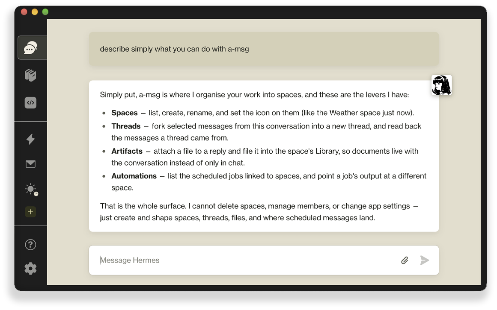

<p align="center">
  
</p>

<h1 align="center">a-msg</h1>

<p align="center">
  A macOS desktop chat for one person's <a href="https://github.com/NousResearch/hermes-agent">Hermes</a> agent and
  their coding agents, also usable in a browser and on a phone.
</p>

<p align="center">
  
</p>

---

A Tauri app talks to a small Python service that runs beside Hermes. The service owns conversations, files and app
actions. Hermes owns agent execution and scheduled jobs.

## Features

- **One main chat with Hermes**, plus separate spaces for other topics. Start a new thread from any selection of
  messages, and it keeps a link back to where it came from.
- **Live replies.** Text streams in as Hermes writes it, and the reply shows the tool in use while Hermes works. Stop
  a reply in progress or retry one that failed.
- **Files both ways.** Attach files to a message, receive files from agents, and find all of them in the Library.
- **Coding sessions.** Run Codex or Claude Code in a folder, on the Hermes host or on another machine through a runner
  that uses that machine's own login. Each session runs at Read only, Workspace or Full access.
- **Automations.** Hermes's scheduled jobs appear on the spaces they post to.
- **Works offline.** Messages queue while the server is unreachable and send when it returns.
- **Private by default.** Devices pair with a single-use code, credentials stay in the macOS Keychain, and the service
  listens on loopback unless told otherwise.
- **Search** across every conversation and file name.
- **Browser and phone.** The service can serve the same interface over HTTPS, signed in with a password and an
  authenticator code. On a phone the rail sits at the bottom and the page respects the notch and home indicator.

## Install

a-msg has two parts: a service that runs on the host where Hermes runs, and the app (macOS, or any browser) that
connects to it. Install the service first.

Each [release](https://github.com/crnst8/a-msg/releases) has the service for Linux (x86_64 and aarch64, glibc 2.35
or newer) and an unsigned Mac app for Apple silicon. The commands below build both from source instead, which needs
no download trust and works on Intel Macs too.

### 1. The service, on the Hermes host

Linux with Hermes 0.23.0 or newer, as the user that runs Hermes:

```bash
git clone https://github.com/crnst8/a-msg.git && cd a-msg && scripts/install-server
```

The script installs any missing build tools for your user (uv, Node 24, pnpm; no sudo), builds the service, installs
it under `~/.local/opt/amsg` as the `amsg.service` user unit, gives the Hermes plugin its credential and prints a
pairing code. Restart the Hermes gateway afterwards so it loads the plugin. To add browser and phone access at the
same time, pass the public HTTPS address; it asks for a sign-in password and prints an authenticator secret:

```bash
scripts/install-server --web-origin https://chat.example.com
```

Then put a reverse proxy in front of it (Caddy and nginx examples in [operations.md](docs/operations.md#browser-access)).
`scripts/install-server --help` lists every option.

### 2. The Mac app

On macOS 12 or newer with the Xcode command line tools (`xcode-select --install`):

```bash
git clone https://github.com/crnst8/a-msg.git && cd a-msg && scripts/install-mac
```

The script installs any missing build tools for your user (uv, Node 24, pnpm, Rust), builds `a-msg.app`, installs it
into `/Applications` (or `~/Applications`) and opens it. Run `amsg pair` on the server and enter the address and code.
The build is unsigned and for your own Mac; see [Signing](#signing).

To reach a service on another host without browser access, use an SSH tunnel and connect to `http://127.0.0.1:8710`:

```bash
ssh -N -L 8710:127.0.0.1:8710 your-hermes-host
```

### Update

Run the same script again from the checkout. On the server it backs up the database, swaps in the new build,
restarts the unit and rolls back if the new build does not start:

```bash
git pull --ff-only && scripts/install-server     # on the server
git pull --ff-only && scripts/install-mac        # on the Mac
```

### Signing

`scripts/install-mac` signs the app ad hoc, which is enough to run it on the Mac that built it. Distributing a build
to other Macs needs an Apple Developer ID and notarization, which this repository does not set up.

## Releases

Versions follow semver and start at 0.1.0. `./publish.sh` reviews and commits work in this checkout and, when asked,
releases it: it writes the notes into [CHANGELOG.md](CHANGELOG.md), then `scripts/release.sh <version>` runs the checks,
sets the version in every manifest (`scripts/set-version`), tags `v<version>` and pushes. The tag runs
`.github/workflows/release.yml`, which builds the Linux service archives on Ubuntu 22.04, runs one on Debian 12,
builds the Mac app with `scripts/install-mac`, and publishes the GitHub release. `./publish.sh status` shows where
things stand. A local `.publish-guard` file (ignored by git) lists strings that must never be committed.

## Repository

| Path | What it holds |
|---|---|
| `apps/desktop` | Tauri shell, React interface and Rust core (`src-tauri`) |
| `services/api` | Python service: FastAPI, SQLite, migrations, tests |
| `integrations/hermes` | Hermes platform plugin |
| `packages/contracts` | OpenAPI document and generated TypeScript types |
| `tests/e2e` | Playwright browser tests |
| `packaging` | Linux installers and the development Docker image |
| `scripts` | Install, release, development, build and check commands |
| `design` | Logo (`design/logo`) and navigation icons (`design/icons`) |
| `docs` | Operations and compatibility |

## Requirements for development

- Node 24 and pnpm 12
- Python 3.13 and uv
- Rust 1.99
- The Tauri [platform prerequisites](https://tauri.app/start/prerequisites/)
- Docker, optional

`scripts/install-mac` and `scripts/install-server` install the first three when they are missing.

Versions are pinned in `.nvmrc`, `package.json`, `.python-version` and `rust-toolchain.toml`.

## Develop

```bash
pnpm install --frozen-lockfile
scripts/dev --seed            # API on 127.0.0.1:8710, interface on http://127.0.0.1:1420
scripts/dev --reset --seed    # start from clean fixtures
scripts/dev --docker --seed   # API in Docker, interface as a normal process
```

`scripts/dev` uses the development-only Test agent, which answers by keyword: `health`, `slow`, `fail`, `file`,
`table`. The API token stays in `.dev/device-token`, which only the Vite proxy reads.

To run the desktop shell against the dev stack, run `pnpm exec tauri dev` in `apps/desktop`.

### Logo

`scripts/brand` rebuilds the logo from `design/logo/source` and copies it into the app: the app icons in
`apps/desktop/src-tauri/icons`, the symbol paths in `apps/desktop/src/components/logo.gen.ts` and the favicon. Run it
after changing the logo source, then commit the results. Usage rules are in [design/logo](design/logo/README.md).

### Check

```bash
scripts/check                 # lint, types, contract drift, unit tests, Rust tests, browser tests
scripts/check --no-e2e        # the same, without a running dev stack
cd tests/e2e && pnpm exec playwright test           # needs scripts/dev --reset --seed running
AMSG_E2E_BROWSER=webkit pnpm exec playwright test   # the same suite on the engine macOS uses
```

### Real Hermes

`scripts/hermes-dev` installs a pinned Hermes into an isolated profile under `~/.cache/amsg` and never touches
`~/.hermes`. It needs `OPENCODE_API_KEY` in `.env` (see `.env.example`).

```bash
scripts/hermes-dev setup
scripts/hermes-dev service    # a-msg in Hermes mode on 127.0.0.1:8720
scripts/hermes-dev gateway    # Hermes gateway with the plugin
```

## Host commands

| Command | Purpose |
|---|---|
| `amsg setup` | Configure this host, write the connector credential, issue a pairing code |
| `amsg serve` | Run the service |
| `amsg pair` | Issue a ten-minute, single-use pairing code |
| `amsg web` | Set up browser access: origin, proxy listener, password and authenticator code |
| `amsg doctor` | Check this installation |
| `amsg backup` | Back up the database and files |
| `amsg restore SOURCE` | Restore into a fresh data directory |
| `amsg runner-token --name NAME` | Issue the credential for a coding agent on another host |
| `amsg runner --root PATH` | Run a coding agent on this host for a service on another host |

## Documents

| Document | Covers |
|---|---|
| [operations.md](docs/operations.md) | Installation, browser access, upgrades, runners, backup, recovery and troubleshooting |
| [compatibility.md](docs/compatibility.md) | Verified versions and upstream behaviour |
| [design/logo/README.md](design/logo/README.md) | Logo files, colours and usage |
| [SECURITY.md](SECURITY.md) | Security model and how to report a vulnerability |
| [NOTICE.md](NOTICE.md) | Third-party material |

## Licence

[MIT](LICENSE).
