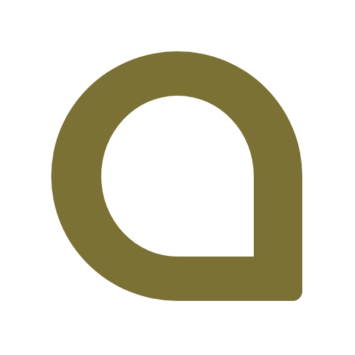

# a-msg logo

The mark is a lowercase **a** whose outer shape and counter are both speech bubbles: round, with one square corner
at the foot of the stem.

## Files

| Folder | Contents | Use |
|---|---|---|
| `symbol/` | `amsg-symbol-{colour,colour-reversed,black,ink,white}.svg` | Symbol alone, 40 px and up |
| `symbol/` | `amsg-symbol-small-{colour,black,white}.svg` | Symbol at 32 px and below (heavier strokes) |
| `app-icon/` | `amsg-app-icon-{colour,dark,light}.svg` | macOS icon grid: 1024 canvas, 824 body, radius 185 |
| `app-icon/` | `amsg-app-icon-{colour,dark,light}-square.svg` | Full-bleed tile, for platforms that apply their own mask |
| `web/` | `favicon.ico`, `favicon.svg`, PNG icons, `site.webmanifest`, `head-snippet.html` | Browser and PWA icons |
| `png/` | Every SVG above as PNG (app icons 1024, symbols 512) | Places that need raster |
| `source/` | `build.py` | Writes the SVG masters |

`colour` is for light backgrounds, `colour-reversed` for dark ones. `white` is drawn slightly thinner than `black` so
it looks the same weight on dark backgrounds.

The primary app icon is `amsg-app-icon-colour`. `scripts/brand` regenerates the SVG masters and copies the logo into
the desktop app: the app icons in `apps/desktop/src-tauri/icons`, the symbol paths in
`apps/desktop/src/components/logo.gen.ts` (drawn by the `Logo` component in the theme's `--brand` colour or the current
text colour) and `apps/desktop/public/assets/branding/favicon.svg`. `png/` and `web/` were exported once with the
logo-design skill's scripts and are not rebuilt by `scripts/brand`.

## Colour

| Name | HEX | RGB | CMYK (starting values) | Role |
|---|---|---|---|---|
| Olive | `#7B7135` | 123 113 53 | 0 8 57 52 | Brand colour: the a, the app-icon tile |
| Ink | `#24251F` | 36 37 31 | 3 0 16 85 | Text, dark tile |
| Paper | `#E3DECC` | 227 222 204 | 0 2 10 11 | Background, mark on dark tiles |
| Light olive | `#B8AD62` | 184 173 98 | 0 6 47 28 | The a on dark backgrounds |

All four come from the app's own tokens. Contrast: olive on paper 3.7:1, olive on white 4.9:1, light olive on ink
6.8:1, ink on paper 11.5:1. CMYK values are a plain conversion; proof them on the stock before printing, and match a
Pantone swatch by eye if spot colour is needed.

Approved pairs: colour on paper or white; colour-reversed on ink; white on olive, ink or black; black on white.

## Clear space and minimum size

Keep clear space equal to half the height of the symbol on every side.

| Version | Smallest |
|---|---|
| Symbol | 40 px with the regular file; 16–32 px with `symbol-small` |

## Name

Write the name in text as **a-msg**, set in the surrounding typeface. There is no wordmark file.

## Do not

- Replace the drawn a with a font's a.
- Stretch, rotate, outline or add effects.
- Recolour outside the palette, or put the olive a on a background below 3:1 contrast.

## Status

- No trademark search has been made.
